# P11. Shepard pairs: Group III's errors at small steps as noise on the interval

> **Under review.** This is a working record, not reviewed
> results. The work was done with AI assistance (Claude) and has not yet been
> checked carefully. Numbers, methods and interpretations may change.

**Status:** first pass; seed 0 (cloud) above, rechecked on seeds 0 to 2 (PC) and their average below; no new fits of its own.
**Paper target:** none in Cusimano et al.; listeners in Shepard (1964)
Fig. 3 and §IV.
**Code:** `tools/relative_pitch/listener_noise.py --interval-noise`.
Design: [relative pitch, Group III](../docs/design/relative-pitch-group-iii.md),
decisions P24 to P26.

## Question

Shepard's Group III (his 14 least accurate listeners on pure tones) judged
the second tone higher in 0.40 of presentations at 9 steps clockwise,
against 0.26 at 8 [Shepard Fig. 3, read by eye]. [P09](P09-shepard-listener-noise.md)
could not produce this rise, because its noise acts on the model's log
odds L, and L is most negative at 9 steps. The design reads the rise as
the down side of a dip at the smallest step in both directions, and
Shepard does too: about 68% correct at a tenth of an octave and about 80%
at three tenths [Shepard §IV]. Can noise on the heard interval, put after
the scene model, describe it, and does the model help?

## Setup

As the design. A pair k steps clockwise is heard as k + ε steps, with ε
Gaussian of SD s steps, wrapped on the circle of 10 steps. Two versions,
both fitted per group by maximum binomial likelihood with P09's trial
counts (260 per step for Group I, 140 for Group III [estimate, listeners ×
10 pairs]), so only differences between log likelihoods mean anything:

- **Interval noise on steps alone** (no model): judged up when the heard
  interval is under 5 steps clockwise. One parameter, s.
- **Interval noise on the model**: the heard interval moves each pair
  along the model's own L against steps from the same starting tone
  (linear between whole steps; L = 0 at 0 and 10 steps, where the tones
  are the same, an assumption), then P09's λ/2 + (1 − λ) · logistic(β · L).
  Three parameters; s = 0 is P09's fit (A).

L is P09's last section: all 90 pairs with the threshold floor and
dominance options, three readings of the first tone, harmonic hypotheses,
seed 0. The fits are on grids (s from 0 to 4 steps in 0.05), with leave
one step out and Shepard's adjacent pairs as in P09.

## Results

All from `data/P11/fit.txt`, made by
`python tools/relative_pitch/listener_noise.py results/data/P09/options/all/*.txt --interval-noise`.
Its first part repeats P09's `fit_all.txt` exactly.



Fraction judged up at 1 to 9 steps clockwise:

| | s (steps) | β | λ | Log likelihood | Held out | 1 | 2 | 3 | 4 | 5 | 6 | 7 | 8 | 9 |
|---|---|---|---|---|---|---|---|---|---|---|---|---|---|---|
| Group III, Fig. 3 | | | | | | 0.74 | 0.78 | 0.83 | 0.75 | 0.52 | 0.29 | 0.24 | 0.26 | 0.40 |
| Noise and lapse on L (P09) | | 1.00 | 0.500 | −745.1 | −749.7 | 0.75 | 0.75 | 0.75 | 0.65 | 0.44 | 0.30 | 0.25 | 0.25 | 0.25 |
| Baseline in steps (P09) | | | 0.515 | −740.1 | −756.8 | 0.74 | 0.74 | 0.74 | 0.73 | 0.52 | 0.27 | 0.26 | 0.26 | 0.26 |
| Interval noise, steps alone | 1.95 | | | **−736.8** | **−738.3** | 0.68 | 0.79 | 0.79 | 0.68 | 0.50 | 0.32 | 0.21 | 0.21 | 0.32 |
| Interval noise on L | 1.10 | 2.11 | 0.350 | −741.3 | −752.2 | 0.68 | 0.78 | 0.76 | 0.64 | 0.46 | 0.30 | 0.21 | 0.21 | 0.32 |
| Group I, Fig. 3 | | | | | | 1.00 | 1.00 | 0.89 | 0.75 | 0.53 | 0.25 | 0.09 | 0.02 | 0.02 |
| Noise and lapse on L (P09) | | 0.247 | 0.010 | −716.5 | −723.8 | 0.99 | 0.97 | 0.89 | 0.69 | 0.42 | 0.21 | 0.06 | 0.02 | 0.01 |
| Baseline in steps (P09) | | | 0 | **−704.6** | **−708.6** | 0.99 | 0.97 | 0.92 | 0.77 | 0.51 | 0.24 | 0.09 | 0.03 | 0.01 |
| Interval noise, steps alone | 1.10 | | | −817.5 | −845.8 | 0.82 | 0.96 | 0.96 | 0.82 | 0.50 | 0.18 | 0.04 | 0.04 | 0.18 |
| Interval noise on L | 0.15 | 0.237 | 0 | −716.4 | −726.7 | 0.99 | 0.97 | 0.89 | 0.69 | 0.42 | 0.21 | 0.06 | 0.02 | 0.01 |

**Adjacent pairs** (Shepard's first sequence of complex tones, not used in
the fit), predicted fraction as the circle predicts: Group III 0.68 with
either interval-noise version (P09: 0.75; Shepard 0.63 to 0.82 per pair);
Group I 0.82 on steps alone and 0.99 on L (Shepard over 0.99).

**Size of the dip.** Accuracy with both directions pooled (k steps
clockwise and k counterclockwise), Group III: 0.670, 0.760, 0.795 and
0.730 at 1 to 4 steps. If every presentation were an independent trial
(280 per step), 2 and 3 steps are 2.4 and 3.4 standard errors above 1
step, and the 9-step point is 2.5 above the 8-step point. Presentations
from one listener are not independent and Fig. 3 is read by eye, so these
overstate the certainty. Group I has no dip: 0.990, 0.990, 0.900, 0.750.

## What it says

- **Noise on the interval describes Group III best, with one parameter
  and no model.** It beats every P09 fit, by 8.3 in log likelihood over
  the model-based fit and 11.4 held out, and gives both the dip at 1 step
  and a rise at 9 (0.32 against Shepard's 0.40). Its SD, 1.95 steps, is
  0.195 octave, about 2.3 semitones, on the interval between two 1/8 s
  tones. Its adjacent-pair prediction (0.68) is closer to the middle of
  Shepard's per-pair range than P09's.
- **Put on the model's log odds it gains 3.8 but loses held out** (−752.2
  against P09's −749.7). The noise then carries the model's slightly early
  crossover (P09) to the neighbouring steps, and three parameters on nine
  points overfit. So for Group III the scene model adds nothing beyond the
  number of steps; what it lacks is a limit on how finely the interval is
  heard (its f0 posteriors are far narrower than a tenth of an octave).
- **Group I is the opposite case.** Noise on the interval alone fits it
  very badly, because it predicts a dip to 0.82 at 1 step where Group I is
  at 1.00, and on L the fit chooses almost none (s = 0.15) and gains
  nothing. Group I's errors sit at the half octave, where the model's are;
  Group III's are also at the smallest steps, where the model makes none.
- So, inferred from these fits: the groups differ in kind, not only in
  amount of noise. This fits Shepard's description of Group III (at a tenth
  of an octave "they give the 'correct' response on only about 68% of the
  presentations") and his remark that the term "tone deaf" may apply to
  an appreciable fraction of the population [Shepard §IV]. The noise sits outside the scene model, as a stage that
  holds or compares the two pitches; this page does not say where in the
  listener it arises.
- **The rise is modest evidence.** It is 2.5 standard errors under
  independence, less in truth, and the fitted curve still falls short at 9
  steps (0.32 against 0.40). The dip and the rise together are what the
  fit rests on.
- **Not checked:** per-trial noise
  in the sensory representation (design P25 (B), not run); Group II, which
  Fig. 3 does not plot; a mixture of guessers and circle-followers within
  Group III, which needs per-listener data Shepard does not give.

## On three seeds

[P12](P12-shepard-seeds.md) refitted all of P09's pairs on seeds 0, 1 and
2 on Cho's PC (decision P27) and averaged them (each hypothesis's
evidence the log of the mean over seeds of its exponential). Group III,
from `data/P09/seeds/fit_s0.txt`, `fit_s1.txt`, `fit_s2.txt` and
`fit_mean.txt` [measured, `listener_noise.py --interval-noise`]:

| Group III | Seed 0 (PC) | Seed 1 | Seed 2 | Seed average | Seed 0 (cloud, above) |
|---|---|---|---|---|---|
| Noise and lapse on L (P09), log likelihood | −745.2 | −744.3 | −747.2 | −746.1 | −745.1 |
| held out | −749.7 | −748.5 | −751.5 | −750.4 | −749.7 |
| Interval noise on L, log likelihood | −740.9 | −738.7 | −745.1 | −743.7 | −741.3 |
| held out | −752.3 | −748.5 | −756.0 | −754.3 | −752.2 |
| s (steps) | 1.05 | 1.05 | 0.70 | 1.20 | 1.10 |

Interval noise on steps alone does not use the model, so it is the same on
every seed: −736.8, held out −738.3, s = 1.95.

- **The conclusion holds on every seed and on the average.** Interval
  noise on steps alone is the best description of Group III; on the
  model's log odds it gains 2 to 6 over P09's fit but is never better held
  out than steps alone (by 10.2 to 17.7).
- **β of the fit on L is not determined on the PC runs**: it reaches the
  top of its grid (10) on all three seeds and the average, against 2.11 on
  the cloud run. With λ at 0.35 to 0.46 the fit only needs the sign of L,
  so this does not change the log likelihoods by much, but the β values
  should not be read.
- For Group I the fit on L chooses s of 0 to 0.20 on every seed, as on the
  cloud run.

## Reproduce

```
python tools/relative_pitch/listener_noise.py results/data/P09/options/all/*.txt --interval-noise
```

Takes about a minute on one CPU. For the three seeds and their average,
`results/data/P09/seeds/{s0,s1,s2,mean}/*.txt` in place of
`results/data/P09/options/all/*.txt` (data from P12).
